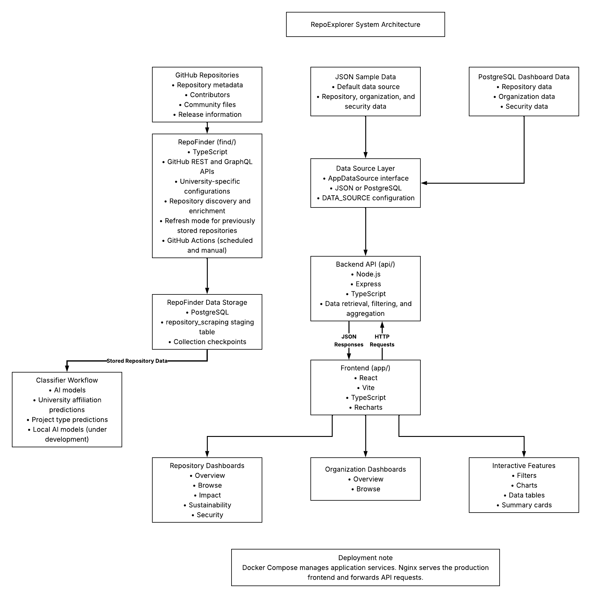

# RepoExplorer System Overview

## 1. Introduction

RepoExplorer is an open-source repository browser developed by [Open Source with SLU](https://oss-slu.github.io). The project builds upon the original work of the [UC OSPO Network](https://ucospo.net) by providing a modern web application for exploring and analyzing open-source repository and organization data.

The application presents data through interactive dashboards, charts, tables, and filters, making it easier for users to understand open-source software activity, impact, sustainability, security, and university affiliations.

## 2. Project Goals

The primary goals of RepoExplorer are to:

- Make open-source repository and organization data more accessible.
- Present complex data through understandable and interactive visualizations.
- Help universities and open-source communities better understand their open-source contributions.
- Allow users to explore data based on specific interests and filtering criteria.
- Support repository discovery, data collection, and enrichment.
- Maintain a scalable and maintainable application architecture.
- Provide documentation and resources that support future development.

## 3. System Architecture

RepoExplorer consists of several major components that work together to collect, store, retrieve, and display open-source data.

The diagram above illustrates the major components of RepoExplorer, including the frontend, backend API, data source layer, PostgreSQL database, and RepoFinder data collection workflow.

RepoFinder's data collection workflow operates separately from the dashboard application's data retrieval workflow.

| Component | Technology | Responsibility |
| --- | --- | --- |
| Frontend | React, TypeScript, Vite, Recharts | User interface, dashboards, charts, tables, and filters |
| Backend | Node.js, Express, TypeScript | API endpoints, data retrieval, filtering, and aggregation |
| Data Source Layer | TypeScript, AppDataSource | Provides a shared interface for accessing data |
| Database | PostgreSQL | Persistent data storage |
| Sample Data | JSON | Alternative data source for development and testing |
| Data Collection | RepoFinder, TypeScript, GitHub APIs | Repository discovery, collection, and enrichment |
| Web Server | Nginx | Serves the production frontend and forwards API requests |
| Infrastructure | Docker, Docker Compose | Manages application services and deployment |

The separation of these components allows developers to work on different areas of the application while maintaining a consistent system structure.

## 4. Project Directory Structure

The repository is organized into the following primary directories:

| Directory | Description |
| --- | --- |
| `app/` | Frontend application, dashboard components, styling, and tests |
| `api/` | Backend application, API routes, data sources, utilities, database connection, and tests |
| `find/` | RepoFinder data collection and enrichment functionality |
| `data/` | Project data resources |
| `docs/` | Project and developer documentation |
| `scripts/` | Project setup and utility scripts |

Additional configuration files in the repository root support Docker, Docker Compose, Nginx, and environment configuration.

## 5. Frontend

The frontend is located in the `app/` directory and is built using React, TypeScript, and Vite.

It provides the primary interface through which users interact with RepoExplorer.

### Responsibilities

The frontend is responsible for:

- Displaying repository and organization dashboards.
- Sending requests to the backend API.
- Presenting returned data through charts, tables, and summary cards.
- Providing navigation between dashboards.
- Managing user-selected filters.
- Displaying repository and organization information.

### Repository Dashboards

| Dashboard | Purpose |
| --- | --- |
| Overview | Displays general repository statistics, language distribution, and university affiliations |
| Browse | Allows users to explore individual repositories |
| Impact | Presents metrics related to repository impact and engagement |
| Sustainability | Presents metrics related to repository activity and sustainability |
| Security | Displays repository security scorecard information and security metrics |

### Organization Dashboards

| Dashboard | Purpose |
| --- | --- |
| Overview | Provides a summary of open-source organization data |
| Browse | Allows users to search, filter, and explore individual organizations |

### Data Visualization

RepoExplorer uses reusable visualization components to present data in an accessible format.

These include:

- Pie charts
- Bar charts
- Data tables
- Data blocks and summary cards

Recharts is used to support chart-based visualizations within the React application.

Reusable components help maintain consistency across dashboards and reduce duplicated code.

### Interactive Filtering

RepoExplorer provides filtering options that allow users to narrow down repository and organization data.

Repository filters include:

- University affiliation
- Affiliation prediction threshold
- Project type
- License
- Programming language
- Minimum number of stars
- Minimum number of forks
- Minimum number of release downloads

Organization filters include:

- University affiliation
- Affiliation prediction threshold

The available filters depend on the selected dashboard and its implementation.

The frontend communicates applicable filter values to the backend, where supported API routes use them to retrieve and process the requested data.

For more information, see the [Layout and Dashboard Integration Documentation](layout.md).

## 6. Backend

The backend is located in the `api/` directory and is built using Node.js, Express, and TypeScript.

It acts as the connection between the frontend and the application's data sources.

### Responsibilities

The backend is responsible for:

- Providing API endpoints for frontend requests.
- Retrieving repository, organization, and security data.
- Processing and filtering data.
- Aggregating data for dashboard visualizations.
- Returning API responses in JSON format.
- Managing the PostgreSQL connection when PostgreSQL is selected.
- Supporting multiple data source implementations.

### API Routes

The API provides route groups for different areas of the application.

| Route | Purpose |
| --- | --- |
| `/overview` | Repository overview statistics and visualizations |
| `/impact` | Repository impact and engagement metrics |
| `/sustainability` | Repository sustainability metrics |
| `/security` | Repository security information |
| `/organization` | Organization statistics and information |

These route groups contain individual endpoints that provide data for specific dashboards, charts, tables, and other frontend components.

For detailed endpoint descriptions, parameters, and responses, see the [API Route Reference](api_routes.md).

For instructions on extending the API, see [Adding a New API Route](new_api_route.md).

## 7. Data Source Architecture

RepoExplorer supports multiple data sources through the shared `AppDataSource` interface.

This interface provides a consistent way for the backend to retrieve repository, organization, and security data regardless of the selected data source.

The API supports two configurable data sources:

### JSON Data Source

The JSON data source:

- Is the default API data source.
- Retrieves data from sample JSON files.
- Supports development and testing.
- Allows developers to work with dashboard data without requiring the API to query PostgreSQL.

### PostgreSQL Data Source

The PostgreSQL data source:

- Retrieves data from a PostgreSQL database.
- Provides persistent data storage.
- Uses the shared database connection pool.
- Converts database records into the format expected by the application.

The selected data source is determined by the `DATA_SOURCE` environment variable.

The shared interface allows API routes to work with either implementation without requiring separate route logic for each data source.

For more information, see the [Data Source Documentation](DataSourceDocumentation.md).

## 8. Database

RepoExplorer uses PostgreSQL to support persistent data storage.

The backend connects to PostgreSQL through a shared connection pool defined in `api/src/db/connect.ts`.

### Database Connection Responsibilities

The connection module is responsible for:

- Creating and managing the PostgreSQL connection pool.
- Executing parameterized SQL queries.
- Verifying database connectivity.
- Closing the connection pool during supported shutdown handling.
- Logging unexpected connection pool errors.

Database connection settings are managed through environment variables rather than hardcoded credentials.

The PostgreSQL connection is initialized by the API when PostgreSQL is selected as its data source.

### Database Configuration

Database configuration includes:

- Database hostname
- Database port
- Database name
- Application database username
- Application database password

Private credentials are stored in a local `.env` file and should never be committed to the repository.

For additional information, see:

- [Database Setup Guide](database.md)
- [API Database Connection](db.md)

## 9. RepoFinder

RepoFinder is located in the `find/` directory and is a rebuild of the original [RepoFinder project](https://github.com/UC-OSPO-Network/repofinder) developed by the UC OSPO Network.

It supports the discovery, collection, and enrichment of open-source repository data associated with configured universities.

### Responsibilities

RepoFinder supports:

- Discovering potential university-affiliated open-source repositories.
- Collecting repository information based on university-specific configurations.
- Interacting with GitHub REST and GraphQL APIs.
- Enriching collected repository data with additional metadata.
- Storing collection checkpoints in PostgreSQL.
- Publishing completed university collection runs to the `public.repository_scraping` staging table.
- Supporting scheduled and manually triggered collection workflows through GitHub Actions.

Discovered repositories are considered candidates and do not necessarily have verified university affiliations.

### Discovery and Refresh Modes

RepoFinder supports two collection modes:

- **Discovery Mode:** Uses university-specific configurations to discover repositories, collect information from GitHub, and publish the collected data to PostgreSQL.
- **Refresh Mode:** Retrieves previously stored repositories and updates their database records with new information from GitHub.

### Classifier Workflow

A separate classifier workflow uses AI models to analyze stored repositories and predict their university affiliations and project types.

Support for local AI models is currently under development.

### Integration with RepoExplorer

RepoFinder operates separately from the frontend and backend API. The dashboard API currently retrieves data through its existing JSON and PostgreSQL data sources rather than directly from the RepoFinder staging table.

For detailed information about RepoFinder configuration, commands, and workflows, see the [RepoFinder Documentation](../../find/README.md).

## 10. System Data Flow

The following sections describe the high-level flow of data through RepoExplorer.

### Data Collection

1. University-specific configurations determine which universities RepoFinder collects data for.
2. RepoFinder discovers potential university-affiliated repositories.
3. Repository information is collected and enriched using GitHub APIs.
4. Collection checkpoints are stored in PostgreSQL.
5. Completed university collection runs are published to the `public.repository_scraping` staging table.
6. Refresh mode allows previously stored repository data to be updated with new information from GitHub.

### Data Classification

1. The separate classifier workflow retrieves stored repository data.
2. AI models analyze the repository information.
3. The classifier predicts university affiliations and project types.

Support for local AI models is currently under development.

### Data Retrieval

1. A user interacts with the React frontend.
2. The frontend sends a request to the appropriate Express API endpoint.
3. The backend retrieves data through the shared `AppDataSource` interface.
4. The selected data source retrieves the requested information from JSON files or PostgreSQL.
5. The backend processes, filters, or aggregates the data as required by the endpoint.
6. The API returns a JSON response to the frontend.

### Data Presentation

1. The frontend receives the API response.
2. Dashboard components use the returned data to display charts, tables, and summary cards.
3. Users can interact with supported filters and dashboard controls.
4. Updated requests allow the frontend to display data based on user-selected criteria.

The RepoFinder data collection and classification workflows operate separately from the dashboard request workflow.

## 11. Infrastructure and Deployment

RepoExplorer uses Docker and Docker Compose to manage its application services.

### Docker Compose

Docker Compose supports the configuration and management of services including:

- Frontend application
- Backend API
- PostgreSQL database

This helps provide a consistent development and deployment environment.

### Nginx

Nginx is used to serve the production frontend and forward API requests to the backend.

### Development Environment

Developers can run the frontend using either:

- The Docker-based frontend served through Nginx.
- The Vite development server, which supports hot reloading.

| Service | Default Local Port |
| --- | --- |
| Docker frontend (Nginx) | 8087 |
| Vite development server | 6284 |
| Backend API | 8765 |
| PostgreSQL host port | 5433 |

For complete installation and setup instructions, see the [Project README](../../README.md).

## 12. Testing and Quality Assurance

RepoExplorer includes automated testing to help maintain application functionality and reliability.

### Frontend Testing

The frontend uses:

- Vitest
- React Testing Library

Frontend tests help verify component behavior, rendering, and user interactions.

### Backend Testing

The backend uses:

- Jest
- Supertest

Backend tests help verify API endpoints, filtering utilities, database connection behavior, and other backend functionality.

### Manual Testing

Manual testing is also important when introducing new features or modifying existing functionality.

Examples include:

- Confirming that dashboards load correctly.
- Verifying that filters return expected results.
- Checking API responses.
- Reviewing frontend layouts at different screen sizes.
- Confirming that database configuration works as expected.
- Verifying documentation and setup instructions.

For testing commands and development workflow information, see the [Contribution Guidelines](../CONTRIBUTING.md).

## 13. Ongoing Development and Future Improvements

RepoExplorer continues to evolve as new functionality is introduced and existing components are improved.

Areas for continued development include:

- Improving dashboard functionality and usability.
- Expanding and refining repository and organization filters.
- Improving frontend responsiveness across different screen sizes.
- Improving API performance through persisted aggregated data.
- Continuing PostgreSQL integration and data management improvements.
- Expanding repository discovery and enrichment capabilities.
- Maintaining and improving automated test coverage.
- Keeping project documentation accurate and up to date.

These improvements support the long-term maintainability, scalability, and usability of RepoExplorer.

## 14. Additional Documentation

The following resources provide more detailed information about specific areas of the project.

| Document | Description |
| --- | --- |
| [Project README](../../README.md) | Project overview, features, and installation instructions |
| [Contribution Guidelines](../CONTRIBUTING.md) | Development workflow and contributor expectations |
| [Coding Conventions](../CONVENTIONS.md) | Project coding standards |
| [API Route Reference](api_routes.md) | API endpoints, parameters, and responses |
| [Database Setup Guide](database.md) | PostgreSQL setup, configuration, and schema |
| [API Database Connection](db.md) | Database connection pool and backend configuration |
| [Data Source Documentation](DataSourceDocumentation.md) | JSON and PostgreSQL data source implementations |
| [Layout and Dashboard Integration](layout.md) | Frontend layout and dashboard development |
| [Adding a New API Route](new_api_route.md) | Instructions for extending the backend API |
| [Developer Setup Scripts](setup_scripts.md) | Additional development setup instructions |
| [RepoFinder Documentation](../../find/README.md) | Repository discovery, collection, and enrichment |
| [SBOM Guide](sbom.md) | Software Bills of Materials and verification |

## 15. Conclusion

RepoExplorer brings together repository discovery, data storage, backend processing, and frontend visualization to make open-source data more accessible and understandable.

Its modular architecture allows individual components to be maintained and improved while supporting the continued development of the overall system.

This document serves as a starting point for future contributors who need to understand the project's structure, responsibilities, and data flow before beginning development.
